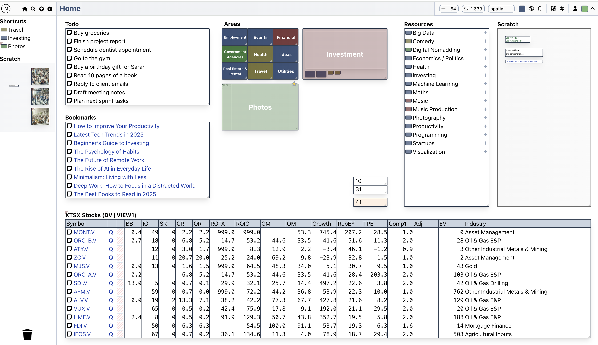

# Infumap

Summary:
- A secure, durable home for all of your information.
- One unified workspace that holds everything:
  - 8 page types, tables, notes, images, ratings and more.
  - Optimized for rapid navigation.
  - Progressively add structure as your needs evolve.
- Tight integration with AI Chat.

<kbd>
  
</kbd>

## Development Status

> [!IMPORTANT]
> The `master` branch is the active development branch and often includes work in progress between releases. For regular use, please prefer the latest tagged release.

I use Infumap to manage all of my personal information and spend a significant part of almost every day using it. This daily use has shaped development and steadily refined the product over a number of years.

Feedback, bug reports, and suggestions are welcome.

*If you choose to use Infumap, please review [LICENSE.txt](LICENSE.txt).*


## Running

For detailed information on deploying Infumap, refer to the [docs](/docs). Currently you need to build Infumap from source. Having done this, everything is provided in a self contained executable. To start Infumap, simple run it from the command line:

```
./infumap web
```

Then point your web browser at `http://localhost:8000`.

Default configuration and data directories will be created automatically.

You can use Infumap locally, or install it on a server on the internet in order to:
- Access your information from anywhere.
- Integrate with other services.
- Share content or reference content authored by others.

## MacOS Settings

Infumap is developed on an Apple Mac, and as such probably works best on this platform (hasn't been tested on others). However,
there are some settings which you should tweak for optimal experience:

In System Preferences / Trackpad:

- Turn off "Smart zoom". If enabled, the system needs to wait to know if a two finger tap was a double tap. Since navigation in Infumap makes frequent use of right clicking (two finger tapping), your experience will be more fluid with this disabled.
- Consider turning off "Swipe between pages".
