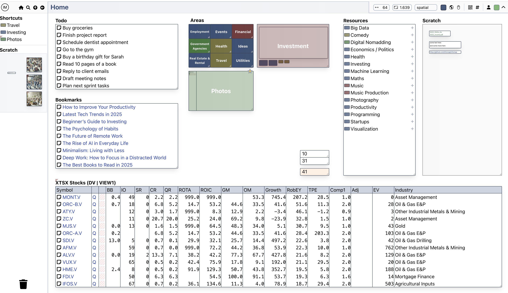

# Infumap

Infumap is a durable home for all of your information. Once you’ve stored something, you can be confident it won’t be lost, that you’ll be able to find it again, and that other people won’t have access to it without your permission.

Infumap is more than a store. I's the how I have long imagined a computer desktop should work.

- **Structure that develops as you work.**
  Start with a few loose notes and documents with little or no organization. Structure is optional; add it only where it helps - you can always search. Group related items, arrange a page, or organize details into a table as the work takes shape.

- **Small details have a place.**
  A note, a link or a rating are items in their own right, alongside a document or an image. You can keep these small pieces of information where they belong without having to create a separate file for each one.

- **Keep the thinking with the material.**
  The documents are only part of the work. There are also questions, comparisons, decisions and things you want to remember. Infumap gives those a place alongside the material they refer to, so you can return to both what you collected and what you made of it.

- **Choose the form that fits.**
  Different information calls for different arrangements. You might use a table to compare places to stay, arrange documents and notes together on a page, or leave a few items loosely grouped until you know what to do with them.

- **Organizing without deciding everything upfront.**
  You don’t need to decide how everything should be organized before you start. Add a document, jot down a thought or rate an option, then arrange and connect those pieces as your understanding develops. The structure can grow with the work.

<kbd>
  
</kbd>

## Development Status

> [!IMPORTANT]
> The `master` branch is the active development branch and often includes work in progress between releases. For regular use, please prefer the latest tagged release.

Infumap is the how I have long imagined a computer desktop should work. I spend a significant part of almost every day using it to manage all of my personal information. This daily use has shaped development and steadily refined the product. Product quality has now reached a point where I'm not embarassed to show it to others, though some rough edges remain.

Feedback, bug reports, and suggestions are welcome.

*If you choose to use Infumap, please review [LICENSE.txt](LICENSE.txt).*


## Running

For detailed information on deploying Infumap, refer to the [docs](/docs). Currently you need to build Infumap from source. Having done this, everything is provided in a self contained executable. To start Infumap, simple run it from the command line:

```
./infumap web
```

Then point your web browser at `http://localhost:8000`.

Default configuration and data directories will be created automatically.

On an Apple Silicon Mac, you can also build a menu bar version:

```sh
./build.sh --macos-menu-bar
./infumap/target/aarch64-apple-darwin/release/infumap-macos
```

It starts the server automatically and adds an Infumap icon to the menu bar. The menu lets you start or stop the server, open Infumap in your browser, view logs in Console, edit server and chat-provider settings, or quit. It uses the same settings and data as `infumap web`. See [macOS menu bar usage](docs/developer.md#macos-menu-bar-binary) for configuration and build details.

You can use Infumap locally, or install it on a server on the internet in order to:
- Access your information from anywhere.
- Integrate with other services.
- Share content or reference content authored by others.

## MacOS Settings

Infumap is developed on an Apple Mac, and as such probably works best on this platform (hasn't been tested on others). However,
there are some settings which you should tweak for optimal experience:

In System Preferences / Trackpad:

- Turn off "Smart zoom". If enabled, the system needs to wait to know if a two finger tap was a double tap. Since navigation in Infumap makes frequent use of right clicking (two finger tapping), your experience will be more fluid with this disabled.
- Consider turning off "Swipe between pages".
